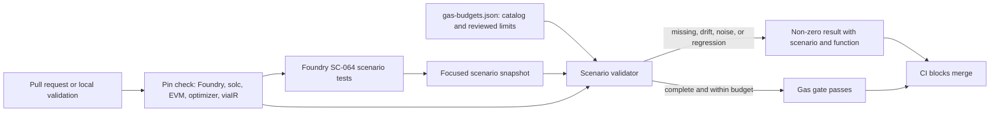
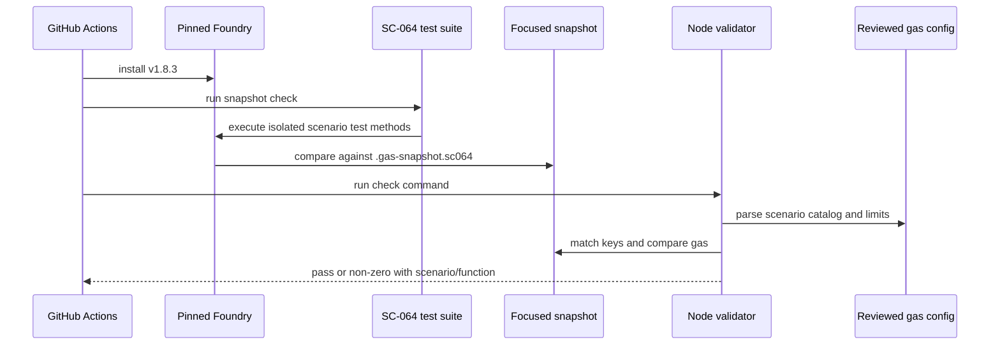

# SC-064: Scenario-Aware, Stable Gas Snapshots

## Document Information

- **Feature Name:** PREWAVE-SC-064 — Make Gas Snapshots Scenario-Aware and Stable
- **Version:** 1.0 (draft)
- **Date:** 2026-10-16
- **Author:** Repository maintainers
- **Reviewers:** Contract maintainers, security reviewers, CI/release owners
- **Related Documents:** [requirements.md](requirements.md)
- **Status:** Draft for technical review; candidate activation remains maintainer-controlled

## Overview

SC-064 strengthens the existing Foundry gas snapshot and budget controls. A focused Foundry suite will measure named scenarios, a scenario catalog will map each measurement to its protocol function and reviewed maximum, and a deterministic Node validator will verify scenario completeness, toolchain identity, snapshot identity, and budget compliance. Existing operation budgets and protocol bounds remain intact.

The authoritative measured toolchain is Foundry `v1.8.3`, Node.js 22, Solidity `0.8.28`, optimizer enabled with 200 runs, `viaIR`, and the Prague EVM target. The pinned Foundry binary reports Prague as the effective default; `foundry.toml` now explicitly pins that same target. Hardhat remains configured for Solidity `0.8.28` / Cancun / `viaIR` / optimizer 200, and the release reproducibility manifest checks compiler settings across both tools. The Foundry gas baseline records its own EVM target rather than assuming it matches Hardhat.

### Design Goals

- Make every measured value attributable to a stable scenario and target function.
- Fail closed for missing, malformed, unstable, over-budget, or toolchain-mismatched inputs.
- Preserve current operation budgets, production contract behavior, security gates, and supported consumer interfaces.

### Key Design Decisions

- Use Foundry as the canonical gas measurement engine because the repository already maintains `.gas-snapshot`, Foundry budget tests, and a Foundry CI snapshot check.
- Keep existing `budgets` and `bounds` members in `config/gas-budgets.json`; add a scenario section compatibly rather than replacing legacy operation budgets.
- Keep the full existing `.gas-snapshot` check and add a focused SC-064 snapshot artifact so the new scenario suite is independently attributable.
- Separate baseline regeneration from validation: regeneration may update the snapshot artifact, but it must never change a reviewed budget automatically.
- Use the existing release-reproducibility pin checks for Solidity compiler/build settings and verify the Foundry executable version and Foundry EVM target used for gas measurements.
- Make no changes to production Solidity contracts, arithmetic, governance, pauses, deployment topology, or consumer ABIs.

## Architecture

### System Context

SC-064 runs locally and in CI against the repository's local EVM test fixtures. It has no runtime contract or deployment effect. The gas workflow uses the pinned Foundry runner, reads the reviewed scenario/budget configuration, checks the focused snapshot, and fails the workflow when any invariant is violated.

### Data Flow Diagram



### High-Level Architecture

1. Foundry scenario tests create or prepare protocol fixture state and measure one explicitly named call path per scenario.
2. `forge snapshot` writes or checks the focused `.gas-snapshot.sc064` artifact, separate from the repository-wide `.gas-snapshot`.
3. `scripts/check-gas-scenarios.mjs` validates the scenario catalog, toolchain pins, and a one-to-one mapping between configured scenarios and snapshot entries, then compares measurements with their reviewed limits.
4. Both the main CI gas job and the standalone gas workflow call the same package command. A failed command is a required failed job; report/artifact upload does not alter its result.

### Technology Stack

| Layer | Technology | Rationale |
|---|---|---|
| Contract measurement | Foundry `v1.8.3`, local EVM | Existing snapshot and Solidity gas-test framework; pinned in CI. |
| Compiler/build settings | Solidity `0.8.28`, Prague for Foundry gas, `viaIR`, optimizer 200 | Explicitly preserves Foundry's pinned effective target; Hardhat's independent target remains Cancun. |
| Scenario/budget data | JSON in `config/gas-budgets.json` | Preserves the documented canonical budget source and existing `budgets`/`bounds` fields. |
| Validation | Node.js 22, native JSON parsing, `node:test` | Matches repository tooling and existing gate self-test conventions. |
| CI | Existing GitHub Actions workflows | Keeps the gate in current required workflow paths. |

## Components and Interfaces

### Component 1: Foundry Scenario Suite

**Path:** `test/gas/ScenarioGasSnapshots.t.sol`

**Purpose:** Measure successful and failing protocol operations under stable, named fixture states.

**Responsibilities:**
- Use isolated local fixtures so setup state is controlled and is not conflated between scenarios.
- Give each scenario a stable test/snapshot key and identify the actual target contract function in the catalog.
- Cover cold/warm and first/repeat access states where applicable; maximum configured input/batch bounds; expected revert paths; upgrade operations; and batch operations.
- Assert expected functional outcomes, including expected reverts, while collecting gas; measurement must not replace functional assertions.
- Read canonical protocol bounds rather than inventing or increasing maximum sizes.

**Interfaces:**
- **Input:** Scenario fixture state, scenario ID, and approved protocol limits.
- **Output:** One Forge test-level gas measurement per scenario and ordinary test pass/fail results.
- **Dependencies:** Foundry `Test`/`Vm` snapshot facilities, contracts and mocks already used by tests, `config/gas-budgets.json`.

**Implementation Notes:**
- Use one uniquely named test key per scenario. Foundry snapshots the test body; fixture construction remains isolated in `setUp`.
- Cold/warm means the EVM access state within the measured transaction; first/repeat means the protocol state before invocation. These are separate dimensions and must be labeled distinctly.
- For revert cases, assert the expected revert selector/reason and measure the attempted operation without treating the reverted call as a successful operation.
- The pinned Foundry runner supports distinct test-level snapshot keys. Do not use the deprecated named call snapshot cheatcode for the checked-in artifact.

### Component 2: Scenario and Budget Configuration

**Path:** `config/gas-budgets.json`

**Purpose:** Retain existing operation limits and declare reviewed scenario metadata and maximums.

**Responsibilities:**
- Preserve the current top-level `schemaVersion`, `budgets`, and `bounds` data and their meanings.
- Add `requiredScenarioFamilies`, `toolchain`, and a `scenarios` collection. Each record contains a stable `id`, one or more scenario `families`, target `function`, Foundry `snapshotKey`, positive `maxGas`, and a concise setup/bound description.
- Declare the required scenario families in validator policy: cold, warm, first invocation, repeated invocation, maximum size, failure/revert, upgrade, and batch. A scenario may satisfy multiple families only when its measurement and setup genuinely exercise each one.
- Keep the existing recommended transaction ceiling as an upper bound on scenario budgets. Budget increases require explicit review and may not alter unrelated entries.

**Illustrative record (field names are normative; values are not approved by this example):**

```json
{
  "id": "claim.create.first-cold",
  "families": ["first", "cold"],
  "function": "TruthBountyWeighted.createClaim",
  "snapshotKey": "ScenarioGasSnapshots:test_claim_create_first_cold()",
  "maxGas": 350000,
  "setup": "New claim, maximum approved statement size"
}
```

**Compatibility:** Existing consumers that read `budgets` or `bounds` continue to receive the same fields and values. Validators must reject unknown/missing SC-064 fields without treating an absent `scenarios` collection as success.

### Component 3: Gas Scenario Validator

**Path:** `scripts/check-gas-scenarios.mjs`

**Purpose:** Enforce scenario coverage, stable identity, pinned toolchain, and reviewed maximums.

**Responsibilities:**
- Parse JSON structurally and validate all required legacy and SC-064 fields.
- Reject duplicate/empty scenario IDs, duplicate snapshot keys, invalid function identities, non-positive limits, and scenario budgets over the configured recommended ceiling.
- Verify required scenario families and a one-to-one mapping between configured scenario keys and the focused Foundry snapshot entries; missing and unexpected entries fail closed.
- Check the active Foundry version against the declared version and use the release reproducibility checker’s toolchain pin reader for Solidity/build settings.
- Reject compiler/toolchain drift, unstable measurements under the repeatability check, missing snapshots, and gas values above the scenario limit.
- Emit deterministic diagnostics naming the scenario ID, function, actual gas, maximum, delta, and relevant toolchain mismatch.
- Return non-zero for every invalid or failing state and never write the snapshot or budget configuration in check mode.

**Interfaces:**
- **Input:** `config/gas-budgets.json`, `.gas-snapshot.sc064`, current Foundry version, `foundry.toml`, `hardhat.config.ts`, and the pinned release manifest.
- **Output:** Stable text diagnostics to stdout/stderr and process exit status 0 only when every check passes.
- **Dependencies:** Node.js built-ins and exported toolchain-pin logic from `scripts/check-release-reproducibility.mjs`.

**CLI:**
- `node scripts/check-gas-scenarios.mjs --check` performs read-only validation.
- Baseline regeneration is performed by the package snapshot-update command; it does not update any budget values.

### Component 4: Package and CI Integration

**Paths:** `package.json`, `.github/workflows/ci.yml`, `.github/workflows/gas-check.yml`

**Purpose:** Provide one reproducible local command and enforce it in every existing gas workflow.

**Responsibilities:**
- Add a focused snapshot regeneration command using the SC-064 test path and `.gas-snapshot.sc064` output.
- Add a check command that runs the focused Foundry snapshot check and scenario validator; preserve the existing `test:gas` public command unless callers are migrated explicitly.
- Pin the Foundry action to the immutable action revision already used by the repository's coverage job and keep the Foundry binary at `v1.8.3`.
- Invoke the same check command from both CI workflow paths; remove `continue-on-error`, missing-artifact skips, and diff-only success behavior from the standalone gas workflow.
- Keep the existing full-suite `forge snapshot --check` in the main CI workflow as an additional check.

**Interfaces:**
- **Input:** Local repository, pinned Node/Foundry toolchain, configured scenarios and snapshots.
- **Output:** Exit code consumed by local shell and GitHub Actions; optional reports are artifacts only.

### Component 5: Validator Self-Tests and Operator Documentation

**Paths:** `test/scripts/check-gas-scenarios.test.mjs`, `docs/gas-snapshots.md`

**Purpose:** Protect the gate itself and document safe baseline maintenance.

**Responsibilities:**
- Test deterministic snapshot regeneration, compiler/toolchain change rejection, noisy measurement rejection, deliberate over-budget regression, missing/duplicate scenario entries, malformed JSON, and completeness of every required family.
- Use temporary fixture files and synthetic measurement values; tests must not rewrite repository budgets or use network access.
- Document the pinned toolchain, local check/update commands, artifact ownership, scenario naming, and review requirements for snapshot/budget updates.

## Data Models

### Scenario Record

```typescript
interface GasScenario {
  id: string;
  families: string[];
  function: string;
  snapshotKey: string;
  maxGas: number;
  setup: string;
}
```

**Validation Rules:** IDs and snapshot keys are non-empty and unique; function identity is explicit; gas limits are safe positive integers within the recommended ceiling; all required families are represented; each configured key occurs exactly once in the focused snapshot.

**Relationships:** Each scenario points to one Foundry measurement. A scenario may be tagged to more than one required family only when one concrete setup legitimately exercises each family.

### Toolchain Identity

```typescript
interface GasToolchain {
  foundryVersion: string;
  solcVersion: string;
  evmVersion: "prague";
  optimizerEnabled: true;
  optimizerRuns: number;
  viaIR: true;
}
```

The Foundry version is checked against the installed binary. Solidity/build settings are cross-checked against both compiler configurations and the approved release reproducibility manifest. The metadata identifies how a baseline was produced; it does not authorize changing compiler or EVM settings.

### Data Flow



## API Design

Not applicable. SC-064 adds no HTTP or on-chain consumer endpoint and changes no Solidity ABI.

## Database Schema Changes

Not applicable. There is no database. The only structured data extension is the additive scenario collection in the existing JSON budget configuration.

## Security Considerations

### Authorization and Governance
- The implementation adds no contract role, permission, governance, or timelock behavior.
- Gas budget changes remain source-controlled and require explicit maintainer review; the check command cannot edit budgets.

### Fail-Closed CI
- Missing snapshots, missing scenario rows, unsupported toolchain metadata, and validator errors fail the job.
- Reporting and artifact upload run after a failure only for diagnostics; they cannot convert the job result to success.
- Existing Solidity security, fuzz, invariant, storage-layout, and reproducibility checks remain enabled.

### Deterministic and Offline Operation
- The validator reads local files and the installed tool version only. It makes no RPC, deployment, key, or secret access.
- Baseline generation uses pinned local tools; the generated snapshot is reviewed as a change, never silently accepted by CI.

### Protocol Boundary
- No production contract code changes are planned. Exact arithmetic, governance/timelock authority, scoped pauses, Optimism/EVM topology, and interface handoffs remain unchanged. No Stellar activation or mainnet deployment is introduced.

## Error Handling

| Category | Result | Diagnostic |
|---|---|---|
| Invalid/missing configuration | Non-zero | JSON path, missing field, or invalid scenario ID. |
| Missing/unexpected snapshot key | Non-zero | Scenario ID and expected/found snapshot key. |
| Toolchain/compiler mismatch | Non-zero | Actual and recorded tool/version/settings. |
| Noisy/non-deterministic measurement | Non-zero | Scenario ID and observed values; no automatic rebaseline. |
| Over-budget regression | Non-zero | Scenario ID, function, actual gas, maximum, and delta. |
| Foundry test/revert assertion failure | Non-zero | Foundry test name and expected-versus-actual behavior. |

## Performance Considerations

### Measurement Load

The focused suite includes only declared gas scenarios and should remain separate from fuzz/invariant campaigns. Maximum-size scenarios use protocol-approved bounds, so the suite measures the worst supported inputs without introducing unbounded loops or workloads.

### Determinism and Noise Policy

- Run snapshots under identical pinned inputs and use exact artifact comparison after stable scenario execution.
- The validator's repeatability test uses deterministic fixture measurements; any observed discrepancy fails and requires investigation.
- Do not use a permissive percentage tolerance to hide noise. If a stable normalization is technically necessary, it must be documented, tested with positive/negative fixtures, and separately reviewed before adoption.

## Testing Strategy

### Unit Tests

`node --test test/scripts/check-gas-scenarios.test.mjs` covers valid configuration, deterministic repeat, changed compiler/toolchain, noisy baseline, deliberate regression, missing/duplicate/malformed scenario entries, and each required family. All invalid cases assert non-zero/failure and actionable scenario/function diagnostics.

### Foundry Scenario Tests

`forge test --match-path 'test/gas/**'` exercises real local fixtures, measured successful calls, max-bound and batch paths, upgrade paths, and revert paths with functional assertions. Existing `TestnetGasBudgets.t.sol`, `GasBoundedExecution.t.sol`, fuzz, invariant, and full-suite snapshot checks remain in place.

### Snapshot Checks

- Regenerate with the dedicated package update command and verify a second unchanged regeneration produces byte-identical output.
- Check with the focused snapshot comparison plus the scenario validator.
- A deliberate fixture-only regression over a scenario cap must fail and name the scenario and function.
- A compiler pin mutation must fail before baseline acceptance.

### CI / End-to-End

Both existing gas workflows run the same fail-closed package check under Foundry `v1.8.3` and Node 22. Missing snapshots and failed Foundry tests block the workflow. Existing complete CI remains a required gate.

## Deployment and Operations

Not applicable to deployment. Baselines are generated and reviewed in source control. The documentation provides local commands and a rebaseline checklist. Rollback consists of reverting the reviewed snapshot/config change; no on-chain rollback or migration is needed.

## Migration and Compatibility

- Keep the existing full `.gas-snapshot` and all existing `budgets`/`bounds` values.
- Add the dedicated `.gas-snapshot.sc064` and additive scenario metadata. Existing budget consumers continue to read their unchanged fields.
- Preserve `npm run test:gas` semantics; introduce focused command names rather than silently redirecting existing consumers.
- No contract ABI, storage layout, deployment artifact, consumer handoff, or database migration changes.

## Requirements Traceability

| Requirement | Design coverage |
|---|---|
| 1. Representative scenario catalog | Scenario suite, configuration schema, completeness validator. |
| 2. Pinned and reproducible baselines | Toolchain identity, Foundry snapshot, release pin cross-check, deterministic regeneration tests. |
| 3. Reviewed scenario budgets and reporting | Scenario validator, explicit budget records, fail-closed diagnostics, no auto-write. |
| 4. Required gate-test coverage | Node synthetic tests, Foundry scenario tests, both CI workflows. |
| 5. Protocol/security boundary preservation | No production Solidity changes, unchanged legacy limits, security/CI constraints. |

## Design Review Checklist

- [x] Architecture uses existing Foundry and Node testing patterns.
- [x] Component responsibilities and data contracts are defined.
- [x] API and database impact are explicitly identified as none.
- [x] All functional and non-functional requirements are mapped.
- [x] Security, determinism, error behavior, and CI failure semantics are specified.
- [x] Confirm Foundry `v1.8.3` test-level snapshot keys under the pinned runner.
- [x] Confirm Foundry `v1.8.3` effective EVM target is Prague and pin it explicitly without changing the effective build.
- [ ] Approve this design before creating implementation tasks.
