# TruthBounty V2 Event Lifecycle Flows

## Purpose
This document maps every approved protocol lifecycle to its required event sequence, correlation identifiers, and ordering constraints. These flows are the authoritative specification for API replay and read model reconstruction.

---

## Flow 1: Standard Claim Verification (Happy Path)

### Description
A claim is created, verified by consensus, and finalized without dispute.

### Event Sequence
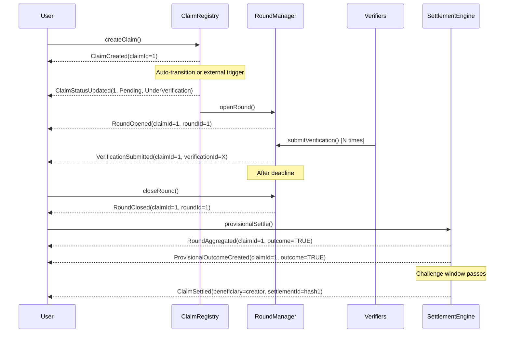

### Required Events (Ordered)
1. `ClaimCreated(claimId, creator, evidenceCID)`
2. `ClaimStatusUpdated(claimId, Pending, UnderVerification)`
3. `RoundOpened(claimId, roundId, roundType=FIRST, ...)`
4. `VerificationSubmitted(claimId, verificationId_i, verifier_i, ...)` × N
5. `RoundClosed(claimId, roundId, ...)`
6. `RoundAggregated(claimId, outcome, confidence, ...)`
7. `ProvisionalOutcomeCreated(claimId, outcome, challengeDeadline, ...)`
8. `ClaimSettled(beneficiary, amount, settlementId)`

### Correlation Identifiers
- **Primary**: `claimId` — Tracks entire lifecycle
- **Round**: `roundId` — Correlates round events (steps 3-5)
- **Verification**: `verificationId` — Correlates individual verifications
- **Settlement**: `settlementId` — Correlates settlement payout

### Ordering Constraints
- `ClaimCreated` MUST be first event for claimId
- `RoundOpened` MUST precede any `VerificationSubmitted` for same claimId
- `RoundClosed` MUST follow `RoundOpened` with same roundId
- `RoundAggregated` MUST immediately follow `RoundClosed`
- `ProvisionalOutcomeCreated` MUST follow `RoundAggregated`
- `ClaimSettled` MUST occur after `challengeDeadline` passes

### Read Model Impact
- **Claims**: Created → status transitions → final outcome
- **Rounds**: Round state machine
- **Verifications**: Vote records per claim
- **Settlements**: Payout records
- **Balances**: Creator receives bounty (if verified true)

---

## Flow 2: Disputed Claim with Appeal Round

### Description
A claim's provisional outcome is challenged, triggering an appeal round with higher stakes.

### Event Sequence
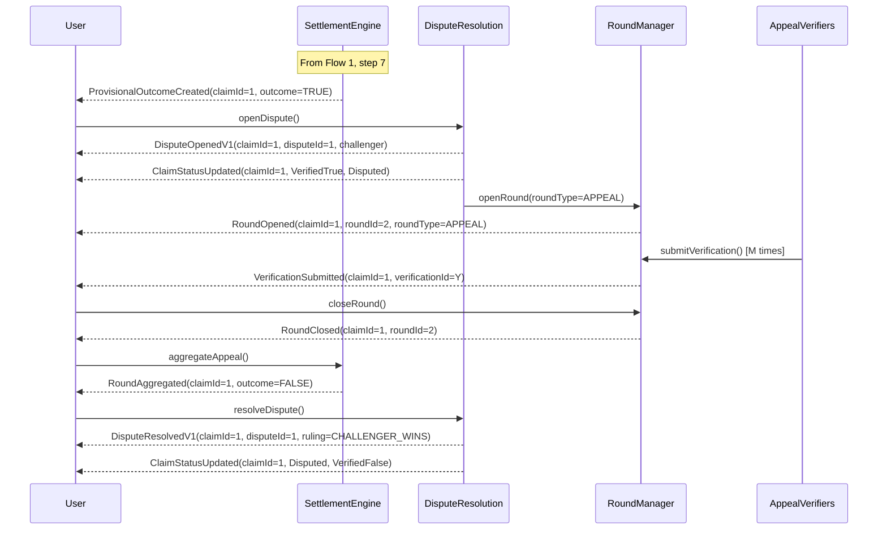

### Required Events (Ordered)
1. `ProvisionalOutcomeCreated(claimId, outcome_initial, ...)`
2. `DisputeOpenedV1(claimId, disputeId, challenger, ...)`
3. `ClaimStatusUpdated(claimId, VerifiedTrue/False, Disputed)`
4. `RoundOpened(claimId, roundId_appeal, roundType=APPEAL, ...)`
5. `VerificationSubmitted(claimId, verificationId_j, ...)` × M
6. `RoundClosed(claimId, roundId_appeal, ...)`
7. `RoundAggregated(claimId, outcome_final, ...)`
8. `DisputeResolvedV1(claimId, disputeId, ruling, ...)`
9. `ClaimStatusUpdated(claimId, Disputed, VerifiedTrue/False)`

### Correlation Identifiers
- **Primary**: `claimId` — Tracks entire lifecycle
- **Dispute**: `disputeId` — Correlates dispute events (steps 2, 8)
- **Appeal Round**: `roundId_appeal` — Correlates appeal round (steps 4-7)
- **Challenger**: `challenger` address — Tracks bond and potential reward

### Ordering Constraints
- `DisputeOpenedV1` MUST occur within `challengeDeadline` from `ProvisionalOutcomeCreated`
- `ClaimStatusUpdated(Disputed)` MUST immediately follow `DisputeOpenedV1`
- Appeal `RoundOpened` MUST specify `roundType=APPEAL`
- `DisputeResolvedV1` MUST occur after appeal `RoundClosed`
- Final `ClaimStatusUpdated` MUST match appeal outcome

### Read Model Impact
- **Claims**: Status → Disputed → final outcome (may change)
- **Disputes**: Dispute record with challenger, bond, ruling
- **Rounds**: Additional appeal round
- **Bonds**: Challenger bond locked → released or slashed based on ruling

---

## Flow 3: Batch Settlement with Partial Failures

### Description
Treasury distributes rewards to multiple beneficiaries in a single transaction, with failure isolation per recipient.

### Event Sequence
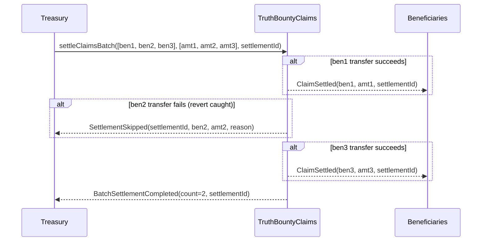

### Required Events (Ordered)
1. `ClaimSettled(beneficiary_i, amount_i, settlementId)` × N_success
2. `SettlementSkipped(settlementId, beneficiary_j, amount_j, reason)` × N_fail
3. `BatchSettlementCompleted(count=N_success, settlementId)` [exactly once]

### Correlation Identifiers
- **Batch**: `settlementId` — Correlates entire batch
- **Beneficiaries**: `beneficiary` addresses — Track individual payouts
- **Success Count**: `count` in `BatchSettlementCompleted` MUST equal number of `ClaimSettled` events with same `settlementId`

### Ordering Constraints
- `BatchSettlementCompleted` MUST be last event in transaction
- All `ClaimSettled` and `SettlementSkipped` MUST precede `BatchSettlementCompleted`
- Events for same `settlementId` MUST occur in same transaction
- `settlementId` MUST be unique (no replay)

### Read Model Impact
- **Settlements**: Records successful and failed payouts
- **Balances**: Updates beneficiary balances only for successful transfers
- **Retry Queue**: Failed beneficiaries queued for retry with new `settlementId`

---

## Flow 4: Verifier Slashing

### Description
A verifier who voted incorrectly has their stake slashed after claim settlement.

### Event Sequence
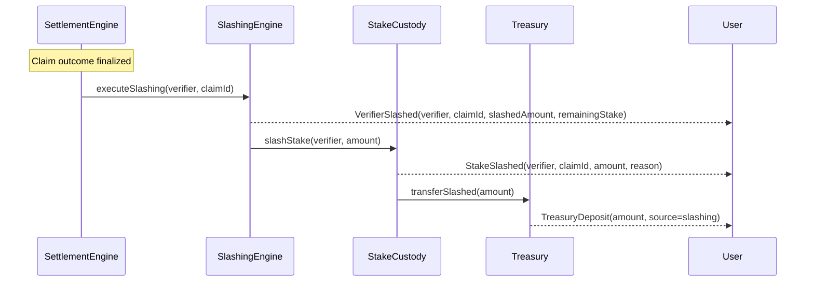

### Required Events (Ordered)
1. `VerifierSlashed(verifier, claimId, slashedAmount, remainingStake, reason, executor)`
2. `StakeSlashed(verifier, claimId, amount, reason, timestamp, version)`
3. [Optional] `TreasuryDeposit(...)` if slashed funds transferred to treasury

### Correlation Identifiers
- **Primary**: `claimId` — Links slash to specific claim
- **Verifier**: `verifier` address — Identifies slashed account
- **Reason**: `reason` hash — Correlates slash justification
- **Amount Consistency**: `slashedAmount` in `VerifierSlashed` MUST equal `amount` in `StakeSlashed`

### Ordering Constraints
- `VerifierSlashed` MUST precede `StakeSlashed`
- Both events MUST occur in same transaction
- Slash MUST occur after claim reaches terminal state (VerifiedTrue/False)

### Read Model Impact
- **Verifier Balances**: Reduces available and total stake
- **Slash History**: Records slash per verifier per claim
- **Treasury**: Increases treasury reserve

---

## Flow 5: Reward Allocation and Claiming

### Description
Rewards are calculated for winning verifiers, allocated to their accounts, and later claimed.

### Event Sequence
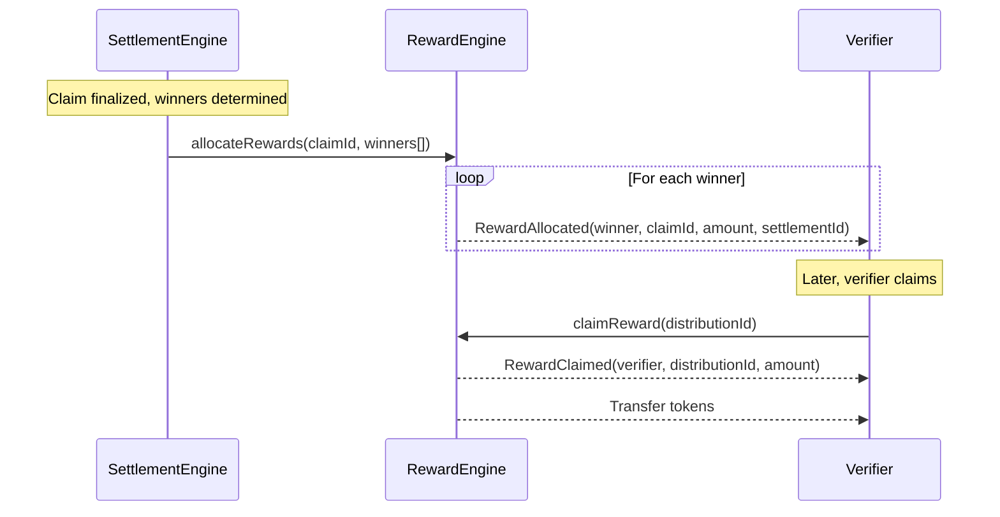

### Required Events (Ordered)
1. `RewardAllocated(recipient, claimId, amount, settlementId)` × N_winners
2. [Later] `RewardClaimed(recipient, distributionId, amount)` [on-demand, per winner]

### Correlation Identifiers
- **Claim**: `claimId` — Links rewards to specific claim
- **Settlement**: `settlementId` — Correlates batch allocation
- **Distribution**: `distributionId` — Correlates individual claim action
- **Recipient**: `recipient` address — Tracks who receives reward

### Ordering Constraints
- `RewardAllocated` MUST occur after claim finalized
- `RewardClaimed` MAY occur in separate transaction, any time after allocation
- `distributionId` in `RewardClaimed` MUST correspond to prior `RewardAllocated`

### Read Model Impact
- **Pending Rewards**: Allocation creates claimable balance
- **Claimed Rewards**: Claim reduces pending, records payout
- **Balances**: Verifier token balance increases on claim

---

## Flow 6: Emergency Pause and Recovery

### Description
Protocol operations are paused in response to a security event, then recovered after remediation.

### Event Sequence
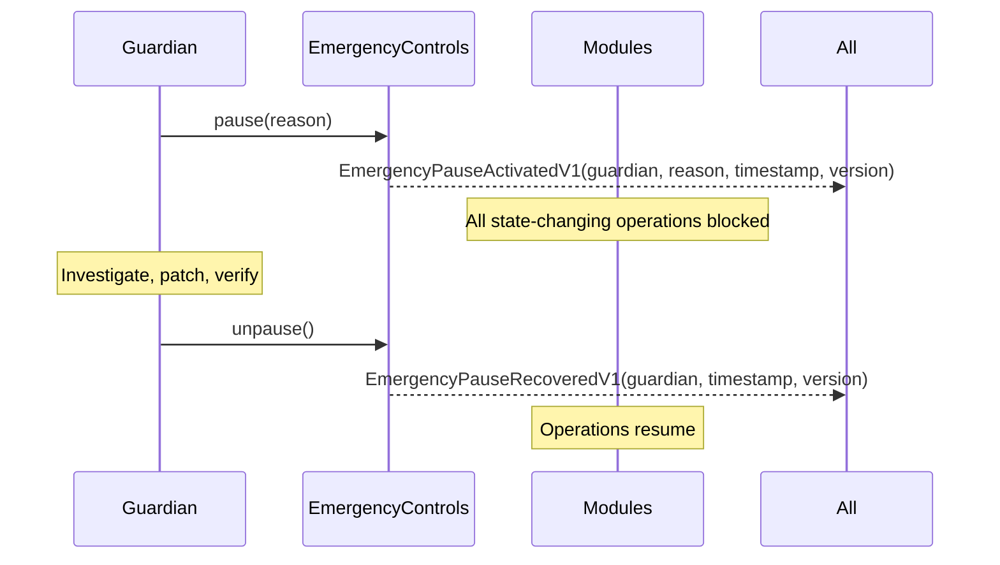

### Required Events (Ordered)
1. `EmergencyPauseActivatedV1(actor, reason, timestamp, version)`
2. [After remediation] `EmergencyPauseRecoveredV1(actor, timestamp, version)`

### Correlation Identifiers
- **Actor**: `actor` address — Identifies guardian or pauser role
- **Reason**: `reason` hash — Documents pause justification
- **Temporal**: Pair events by `timestamp` proximity and actor

### Ordering Constraints
- `EmergencyPauseRecoveredV1` MUST occur after `EmergencyPauseActivatedV1`
- Multiple pause/unpause cycles MAY occur
- All operations between pause and unpause MUST revert

### Read Model Impact
- **System Status**: Displays pause state in UI
- **Transaction History**: Records pause/unpause events in audit log
- **Alerts**: High-priority notification to all users

---

## Flow 7: Governance Role Assignment

### Description
A governance proposal grants a new role to an account, or revokes an existing role.

### Event Sequence (Grant)
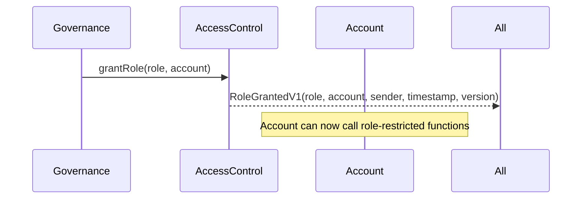

### Event Sequence (Revoke)
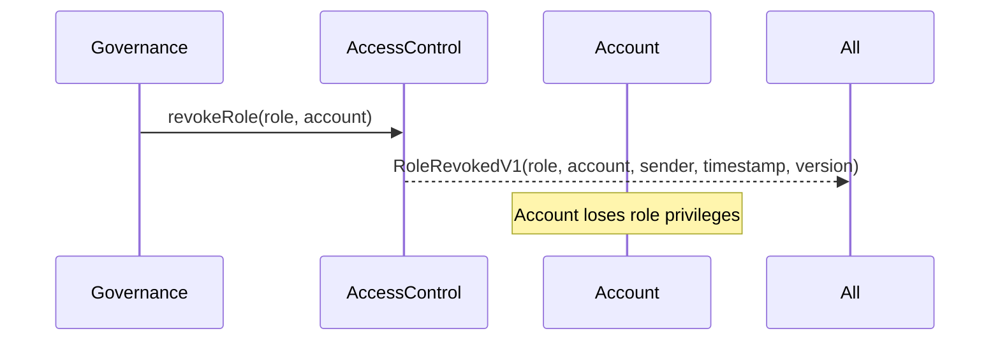

### Required Events
- **Grant**: `RoleGrantedV1(role, account, sender, timestamp, version)`
- **Revoke**: `RoleRevokedV1(role, account, sender, timestamp, version)`

### Correlation Identifiers
- **Role**: `role` hash — Identifies specific role (e.g., ADMIN_ROLE, PAUSER_ROLE)
- **Account**: `account` address — Target of role change
- **Sender**: `sender` address — Authority executing role change

### Ordering Constraints
- No specific cross-event ordering required
- Grant and revoke are independent operations

### Read Model Impact
- **Access Control Lists**: Updates role membership
- **Audit Trail**: Records all role changes for governance review
- **Security Monitoring**: Alerts on sensitive role changes (ADMIN, PAUSER)

---

## Flow 8: UUPS Contract Upgrade

### Description
A modular contract is upgraded to a new implementation via UUPS proxy pattern.

### Event Sequence
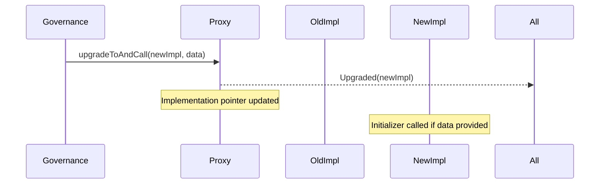

### Required Events
1. `Upgraded(implementation)` [from UUPSUpgradeable]

### Correlation Identifiers
- **Proxy Address**: Event emitted from proxy contract address
- **New Implementation**: `implementation` parameter

### Ordering Constraints
- Upgrade MUST follow governance approval
- Upgrade MUST pass storage layout compatibility check
- Optional initializer call MUST occur in same transaction

### Read Model Impact
- **Implementation Registry**: Records new implementation address per proxy
- **Version History**: Tracks upgrade timeline
- **Audit Log**: Records governance-approved upgrades

---

## Flow 9: Stake Deposit and Locking

### Description
A verifier deposits stake, which is then locked when participating in a verification round.

### Event Sequence
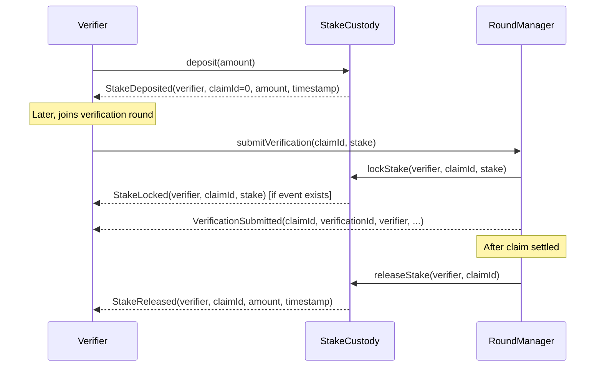

### Required Events (Ordered)
1. `StakeDeposited(account, claimId=0, amount, timestamp, version)`
2. [When used] `VerificationSubmitted(claimId, verificationId, verifier, ..., stake)`
3. [After settlement] `StakeReleased(account, claimId, amount, timestamp, version)`

### Correlation Identifiers
- **Verifier**: `account`/`verifier` address — Consistent across events
- **Claim**: `claimId` — Links stake lock to specific claim
- **Amount**: Amount locked in `VerificationSubmitted.stake` SHOULD match released amount (if winning side)

### Ordering Constraints
- `StakeDeposited` MUST precede `VerificationSubmitted` for same verifier
- `StakeReleased` MUST occur after claim settlement
- Deposit MUST have sufficient balance for intended lock

### Read Model Impact
- **Available Balance**: `StakeDeposited` increases, `StakeReleased` increases
- **Locked Balance**: Implicit lock during verification, released after settlement
- **Total Balance**: Sum of available and locked

---

## Flow 10: Multi-Round Claim (First + Appeal)

### Description
Complete flow showing a claim going through initial verification, then appeal, with full event trace.

### Event Sequence
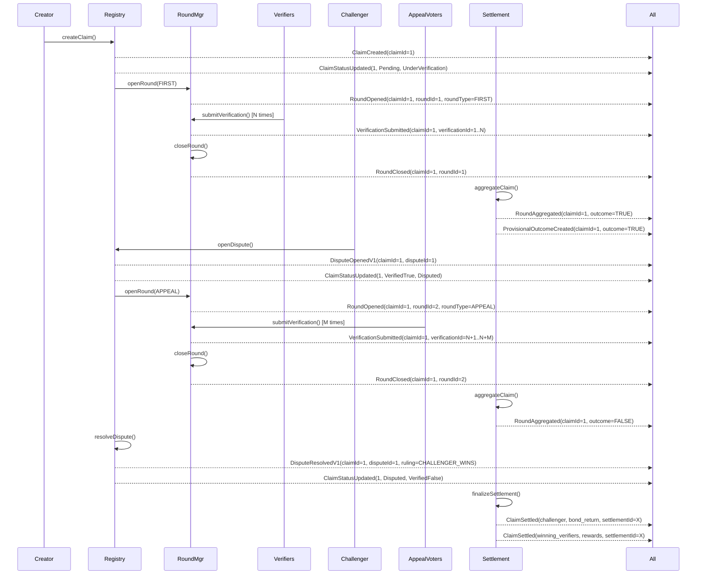

### Complete Event List (Ordered)
1. `ClaimCreated(1, creator, evidenceCID)`
2. `ClaimStatusUpdated(1, Pending, UnderVerification)`
3. `RoundOpened(1, 1, FIRST, ...)`
4. `VerificationSubmitted(1, 1, verifier1, ...)` × N
5. `RoundClosed(1, 1, ...)`
6. `RoundAggregated(1, TRUE, ...)`
7. `ProvisionalOutcomeCreated(1, TRUE, challengeDeadline, ...)`
8. `DisputeOpenedV1(1, 1, challenger, ...)`
9. `ClaimStatusUpdated(1, VerifiedTrue, Disputed)`
10. `RoundOpened(1, 2, APPEAL, ...)`
11. `VerificationSubmitted(1, N+j, verifier_j, ...)` × M
12. `RoundClosed(1, 2, ...)`
13. `RoundAggregated(1, FALSE, ...)`
14. `DisputeResolvedV1(1, 1, ruling=CHALLENGER_WINS)`
15. `ClaimStatusUpdated(1, Disputed, VerifiedFalse)`
16. `ClaimSettled(challenger, bond, settlementId_X)`
17. `ClaimSettled(winning_verifiers, rewards, settlementId_X)` × K
18. `BatchSettlementCompleted(K+1, settlementId_X)`

### Correlation Identifiers
- **claimId**: `1` — Tracks entire lifecycle
- **roundId**: `1` (first), `2` (appeal) — Separates round phases
- **disputeId**: `1` — Links dispute events
- **settlementId**: `settlementId_X` — Batches final payouts
- **verificationIds**: `1..N+M` — Individual votes across both rounds

### Key Observations
- Total events: 18 minimum (more if additional verifications)
- Three distinct phases: Initial verification, Dispute/Appeal, Settlement
- Status transitions: Pending → UnderVerification → VerifiedTrue → Disputed → VerifiedFalse
- Two rounds with separate roundIds but same claimId
- Outcome flips from TRUE to FALSE after appeal

---

## Correlation Identifier Reference

### claimId
- **Type**: `uint256`
- **Uniqueness**: Globally unique, monotonically increasing
- **Events**: ClaimCreated, ClaimStatusUpdated, RoundOpened, VerificationSubmitted, RoundClosed, RoundAggregated, ProvisionalOutcomeCreated, DisputeOpenedV1, DisputeResolvedV1, all settlement/reward/slash events
- **Reconstruction**: Primary key for claim entity

### roundId
- **Type**: `uint256`
- **Uniqueness**: Globally unique, monotonically increasing
- **Events**: RoundOpened, RoundClosed, all round-scoped events
- **Reconstruction**: Primary key for round entity, foreign key to claimId

### verificationId
- **Type**: `uint256`
- **Uniqueness**: Globally unique, monotonically increasing
- **Events**: VerificationSubmitted
- **Reconstruction**: Primary key for verification entity, links to claimId and verifier

### disputeId
- **Type**: `uint256`
- **Uniqueness**: Globally unique, monotonically increasing (one per claim max)
- **Events**: DisputeOpenedV1, DisputeResolvedV1
- **Reconstruction**: Primary key for dispute entity, foreign key to claimId

### settlementId
- **Type**: `bytes32`
- **Uniqueness**: Globally unique, opaque identifier
- **Events**: ClaimSettled, BatchSettlementCompleted, SettlementSkipped, RewardAllocated
- **Reconstruction**: Groups settlement batch operations, replay prevention

### distributionId
- **Type**: `bytes32`
- **Uniqueness**: Globally unique per reward claim
- **Events**: RewardClaimed
- **Reconstruction**: Links reward claim to prior allocation

### role
- **Type**: `bytes32`
- **Uniqueness**: Unique per role type (keccak256 of role name)
- **Events**: RoleGrantedV1, RoleRevokedV1
- **Reconstruction**: Access control role identifier

### actor/verifier/creator/challenger/recipient
- **Type**: `address`
- **Uniqueness**: Ethereum address (not globally unique, reused across events)
- **Events**: Most events include an actor/subject address
- **Reconstruction**: Links events to accounts, enables per-user queries

---

## Test Requirements per Flow

### Flow 1: Standard Claim Verification
- ✅ All 8 events emitted in single end-to-end test
- ✅ claimId consistent across all events
- ✅ roundId consistent in round events
- ✅ Status transitions match expected sequence
- ✅ Timestamp monotonically increasing

### Flow 2: Disputed Claim
- ✅ DisputeOpenedV1 triggers status change to Disputed
- ✅ Appeal roundType = 1 (APPEAL)
- ✅ Appeal roundId ≠ first roundId
- ✅ Outcome may change after appeal
- ✅ disputeId unique per claim

### Flow 3: Batch Settlement
- ✅ Multiple ClaimSettled events in one transaction
- ✅ Same settlementId across batch
- ✅ BatchSettlementCompleted count matches successes
- ✅ SettlementSkipped emitted for failures
- ✅ settlementId not replayable

### Flow 4: Slashing
- ✅ VerifierSlashed and StakeSlashed in same tx
- ✅ Amounts match between events
- ✅ claimId correlates to claim outcome
- ✅ verifier balance decreases correctly

### Flow 5: Rewards
- ✅ RewardAllocated emitted per winner
- ✅ RewardClaimed can occur in separate tx
- ✅ claimable balance matches allocations
- ✅ No double-claim with same distributionId

### Flow 6: Pause/Unpause
- ✅ State changes blocked between pause and unpause
- ✅ reason hash recorded
- ✅ actor has PAUSER_ROLE

### Flow 7: Role Changes
- ✅ RoleGrantedV1 enables role-restricted calls
- ✅ RoleRevokedV1 blocks role-restricted calls
- ✅ sender has admin authority

### Flow 8: Upgrades
- ✅ Upgraded event emitted from proxy
- ✅ Implementation address correct
- ✅ Storage layout compatible

### Flow 9: Stake Lifecycle
- ✅ Deposit increases balance
- ✅ Lock reduces available (implicit or explicit event)
- ✅ Release restores available
- ✅ Slash reduces total

### Flow 10: Multi-Round
- ✅ All 18+ events in correct order
- ✅ Status transitions valid
- ✅ Round separation clear
- ✅ Final outcome reflects appeal

---

## Indexer Implementation Guidance

### Event Processing Order
1. Sort logs by (blockNumber, transactionIndex, logIndex)
2. Process in order, updating read models incrementally
3. Checkpoint after each block for reorg recovery

### Correlation Strategy
- Maintain lookup tables: claimId → events, roundId → events, etc.
- Index both directions: claimId → rounds, roundId → claimId
- Store complete event history for audit trail

### Reorg Handling
- On reorg detection:
  1. Identify last safe block
  2. Rollback read models to that state
  3. Re-apply events from new canonical chain
  4. Validate correlation key consistency

### State Reconstruction
- For any entity (claim, round, verifier), query all related events
- Apply events in order to rebuild current state
- Verify storage query matches event-derived state

---

## Validation Rules

### Cross-Event Validation
1. **claimId Monotonicity**: Each new ClaimCreated must have claimId = max(previous) + 1
2. **roundId Uniqueness**: Each RoundOpened must have unique roundId
3. **Status Transitions**: ClaimStatusUpdated must follow valid state machine
4. **Settlement Uniqueness**: settlementId never repeated
5. **Temporal Consistency**: Event timestamps weakly monotonic within transaction

### Financial Reconciliation
1. **Balance Equation**: Deposits - Withdrawals - Slashes + Releases = Storage Balance
2. **Reward Pool**: Funded - Distributed - Claimed = Remaining Pool
3. **Settlement Total**: Σ ClaimSettled.amount = Expected settlement amount

### Correlation Validation
1. **Round-Claim**: Every RoundOpened.claimId must have prior ClaimCreated
2. **Verification-Round**: Every VerificationSubmitted.claimId must have active round
3. **Dispute-Claim**: Every DisputeOpenedV1.claimId must be in challengeable state
4. **Settlement-Claim**: Every settlement event must reference finalized claim

---

## Appendix: Event Signature Reference

```solidity
// Core claim events
event ClaimCreated(uint256 indexed claimId, address indexed creator, string evidenceCID);
event ClaimStatusUpdated(uint256 indexed claimId, ClaimStatus indexed oldStatus, ClaimStatus indexed newStatus);

// Round events
event RoundOpened(uint256 indexed claimId, uint256 indexed roundId, uint8 roundType, ...);
event RoundClosed(uint256 indexed claimId, uint256 indexed roundId, uint64 closedAt, uint256 totalVotes);
event VerificationSubmitted(uint256 indexed claimId, uint256 indexed verificationId, address indexed verifier, ...);

// Aggregation events
event RoundAggregated(uint256 indexed claimId, Outcome indexed outcome, ...);
event ProvisionalOutcomeCreated(uint256 indexed claimId, Outcome indexed outcome, ...);

// Dispute events
event DisputeOpenedV1(uint256 indexed claimId, uint256 indexed disputeId, address indexed challenger, ...);
event DisputeResolvedV1(uint256 indexed claimId, uint256 indexed disputeId, address resolver, ...);

// Settlement events
event ClaimSettled(address indexed beneficiary, uint256 amount, bytes32 indexed settlementId);
event BatchSettlementCompleted(uint256 count, bytes32 indexed settlementId);
event SettlementSkipped(bytes32 indexed settlementId, address indexed beneficiary, ...);

// Reward events
event RewardAllocated(address indexed recipient, uint256 indexed claimId, uint256 amount, bytes32 indexed settlementId);
event RewardClaimed(address indexed recipient, bytes32 indexed distributionId, uint256 amount);

// Slashing events
event VerifierSlashed(address indexed verifier, uint256 indexed claimId, ...);
event StakeSlashed(address indexed account, uint256 indexed claimId, uint256 amount, bytes32 indexed reason, ...);

// Custody events
event StakeDeposited(address indexed account, uint256 indexed claimId, uint256 amount, ...);
event StakeReleased(address indexed account, uint256 indexed claimId, uint256 amount, ...);

// Governance events
event RoleGrantedV1(bytes32 indexed role, address indexed account, address indexed sender, ...);
event RoleRevokedV1(bytes32 indexed role, address indexed account, address indexed sender, ...);

// Emergency events
event EmergencyPauseActivatedV1(address indexed actor, bytes32 indexed reason, ...);
event EmergencyPauseRecoveredV1(address indexed actor, ...);

// Upgrade events
event Upgraded(address indexed implementation);
```

---

## Document Maintenance

- **Owner**: Protocol Team
- **Reviewers**: API Team, Frontend Team, Audit Team
- **Update Trigger**: Any event signature change, new lifecycle added, correlation key change
- **Verification**: Event snapshot tests must pass after any update
